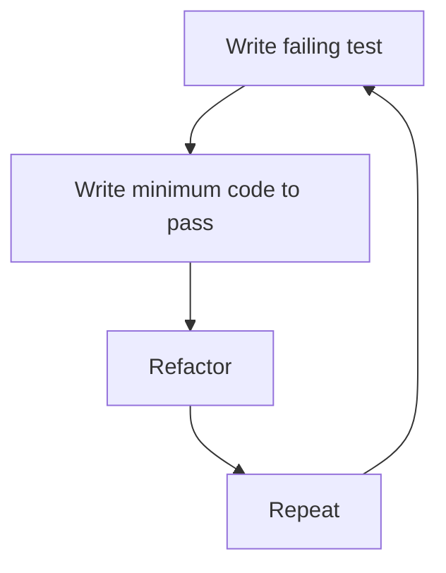

import TawkWidget from '../../../../components/TawkWidget.astro';
import UniversalContentContributors from '../../../../components/UniversalContentContributors.astro';
import InArticleAd from '../../../../components/InArticleAd.astro';
import Copyright from '../../../../components/Copyright.astro';
import BionicText from '../../../../components/BionicText.astro';
import TailwindWrapper from '../../../../components/TailwindWrapper.jsx';
import { Tabs, TabItem } from '@astrojs/starlight/components';
import { Card, CardGrid, Badge, Steps, LinkButton, FileTree } from '@astrojs/starlight/components';

<UniversalContentContributors 
  contributors={frontmatter.contributors}
/>


import PhilosophyOfScienceEngineeringComments from '../../../../components/philosophy-of-science-engineering/PhilosophyOfScienceEngineeringComments.astro';

A new cold room passes its commissioning check, the check made before an installation is handed to its owner. The technician switched it on, on a cool morning with the room empty, watched it reach 4 °C and signed the form. On the first hot afternoon, full of warm produce, it stays at 9 °C for hours. The check told you nothing, because the room could not have failed it. A test is worth only what it could have shown you. This lesson gives you the question to ask of any test: how hard did it try to make the system fail? #Falsifiability #Testing #Engineering

## The Asymmetry of Evidence

Karl Popper, a philosopher of science, saw that confirming a general claim and refuting it are not equal tasks. No number of agreeing cases proves a general claim true. One case against it proves it false.

Take the claim "All swans are white". A million white swans agree with it and prove nothing. One black swan ends it.

### In Engineering Terms

| Claim | 1000 Confirmations | 1 Refutation |
|-------|-------------------|--------------|
| "The standby generator always starts" | 1000 good test starts | One failed start disproves the claim |
| "The bridge supports 10 tons" | 1000 trucks cross safely | One collapse disproves the claim |
| "The cold room never passes 8 °C" | 1000 hours below 8 °C | One hour at 9 °C disproves the claim |
| "The sensor reads within 1% accuracy" | 1000 accurate readings | One reading outside 1% disproves the claim |

So **the test that teaches you most is the test most likely to produce a failure.** If you test only the cases you expect to pass, you collect confirmations and learn little.

```text
 Claim: "all swans are white"

 ┌─────────────────────┐
 │ white swan 1        │   each one adds a little
 │ white swan 2        │   confidence, and none
 │ ...                 │   of them proves the claim
 │ white swan 1000     │
 └─────────────────────┘
 ┌─────────────────────┐
 │ ONE black swan      │──> the claim is false
 └─────────────────────┘
```

## Confirmation Bias in Testing

<InArticleAd />


Confirmation bias is the habit of looking for, and remembering, the evidence that agrees with what you already believe. Everyone has it. In testing it works in four ways.

### How Confirmation Bias Infects Testing

<Steps>
1. **You choose the tests.** You write tests for the cases you thought of during design, and those are the cases you expect to pass. The cases you did not think of are the ones most likely to hide a fault.

2. **You read the result kindly.** "The room reached 8.4 °C against a limit of 8.0 °C, but that is close enough." Did you check the specification, or did you want a pass?

3. **You forget the odd failures.** You remember the 47 tests that passed and forget the 3 that failed once and "could not be repeated". Such a failure is often a real fault with a rare trigger.

4. **You have invested.** After three months of work on a design, you want it to work. That makes you a poor tester of it.
</Steps>

### The Happy Path Problem

<Card title="Happy Path Testing" icon="warning">
The happy path is the case where everything goes as planned: the right input, in the right order, under normal conditions. Testing only the happy path is the most common form of confirmation bias in testing.
</Card>

Take the commissioning of a controller that runs a borehole pump to fill a tank.

| What is usually tested | What should also be tested |
|------------------------|----------------------------|
| The tank is low: the pump starts | The level sensor is unplugged: does the pump stop, or run without end? |
| The tank is full: the pump stops | The borehole runs dry: does the pump stop before it is damaged? |
| | The power fails and returns during a run: does the pump restart safely? |
| | The supply voltage is low: does the controller stop the pump? |
| | Two commands arrive together: which one wins? |

If your test plan holds only the left column, you have not tested the system. You have confirmed your assumptions.

## Negative Testing: The Popperian Approach

<InArticleAd />


A negative test is a deliberate attempt to make the system fail. It is Popper's idea applied to engineering: you stop asking "does it work?" and ask "how does it break?"

### Categories of Negative Tests

<Tabs>
<TabItem label="Boundary Conditions">
Test at the exact edges of the specified ranges:

- supply voltage at the minimum, at the maximum, and 1% beyond each
- temperature at both ends of the operating range
- a tank, a buffer or a memory at exactly full
- a timer at zero, at its maximum, and at the moment it returns to zero

If the specification says "operates from 3.0 V to 3.6 V", test at 2.9 V and 3.7 V as well. What happens outside the range often tells you more than what happens inside it.
</TabItem>

<TabItem label="Invalid Inputs">
Give the system inputs that break its assumptions:

- a sensor that is unplugged, shorted, or reads an impossible value
- text where the program expects a number
- a negative value where only positive values make sense
- a damaged message on a communication line
- commands sent in the wrong order

Every input check that you forgot is a fault that a user will find for you.
</TabItem>

<TabItem label="Stress and Overload">
Push the system past its design capacity:

- full load without a pause for 72 hours
- memory used until none is left
- power switched off and on every 100 ms

A stress test shows the assumptions you did not know you had made.
</TabItem>

<TabItem label="Environmental">
Put the system in the conditions of the real site:

- fast changes from hot to cold and back
- electrical interference from nearby motors and radios
- vibration, dust and humid air
- a supply with noise, short dropouts and surges

The laboratory is not the site.
</TabItem>
</Tabs>

### A worked case: a commissioning check that can fail

The cold room of the opening must hold produce between 2 and 8 °C. Write its commissioning check again, so that the room can fail it.

<Steps>
1. **Write the claim with numbers.** "On a hot afternoon, with a normal day's loading, the air in the room does not stay above 8 °C for more than 30 minutes."

2. **List the conditions most likely to break it.** High outdoor temperature. A full load of warm produce. A door that is opened often. The first check, an empty room on a cool morning, had none of these.

3. **Write the failing result before the test.** The room fails if the logger shows the air above 8 °C for more than 30 minutes without a break.

4. **Run the hardest case.** At 14:00, with 33 °C outdoors, the staff load 800 kg of produce at field temperature. The logger shows the air above 8 °C for 50 minutes, with a peak of 9.5 °C.

5. **Read the result.** 50 minutes against a limit of 30: the room has failed. It can hold a cold load, but it cannot cool 800 kg of warm produce at one time.

6. **Change one thing and test again.** The load is split into batches of 300 kg, one hour apart. On a similar afternoon the air is above 8 °C for 10 minutes, with a peak of 8.3 °C. The room passes, and the loading rule is written into the handover papers.
</Steps>

The first check produced a signature. The second produced a failure before any stock was lost, and a rule that prevents it.

### Fuzz Testing: Automated Falsification

Fuzz testing, or fuzzing, is a negative test run by a machine. A program sends very large numbers of random and damaged inputs to the program under test and records every crash, hang or wrong answer.

```
Basic Fuzzing Concept:

  for iteration in 1..1000000:
    input = generate_random_data()
    result = system_under_test(input)
    if result == crash or hang or unexpected:
      log(iteration, input, result)
      // Found a failure! This is GOOD NEWS.
      // You now know something you didn't before.
```

Fuzzing has found serious faults in web browsers, operating systems and embedded firmware. It works because it tries inputs that no person would think of.

## Case Study: The Challenger Disaster

<InArticleAd />


On January 28, 1986, the Space Shuttle Challenger broke apart 73 seconds after launch, and all seven crew members died. The technical cause was a seal that failed in the right solid rocket booster. The deeper cause was an error of reasoning about evidence.

### The Technical Problem

The boosters were built in segments. Rubber rings called O-rings sealed the joints between the segments against the hot gas inside. In the cold, the rubber became stiff and sealed poorly.

### The Evidence Before Launch

Engineers at Morton Thiokol, the maker of the boosters, had records of O-ring damage on earlier flights:

| Flight | Temperature at Launch | O-Ring Damage |
|--------|----------------------|---------------|
| STS-51C | 53 F (12 C) | Severe erosion |
| STS-61A | 75 F (24 C) | Blow-by at two joints |
| STS-61C | 58 F (14 C) | Erosion |
| STS-51L (Challenger) | 36 F (2 C) | Catastrophic failure |

The temperatures for the earlier flights are the calculated joint temperatures used by the Rogers Commission, which investigated the accident. Seen flight by flight, the record looked mixed, because damage had also occurred on a warm day. Seen as a whole, it did not: every flight below 65 F had O-ring damage, and only a few of the warmer flights did.

The night before the launch, the Thiokol engineers Roger Boisjoly and Allan McDonald argued against it. The forecast was for temperatures near or below freezing, far colder than at any earlier launch. It was 36 F at the moment of launch.

### The Reasoning Failure

NASA managers asked Thiokol to **prove that it was not safe to launch.** That is the wrong question. It puts the burden of proof on the wrong side.

<Card title="The Inverted Question" icon="warning">
The right question is not "Can you prove it is unsafe?" but "Can you show that it is safe at this temperature?" No shuttle had launched below 53 F, so there was no evidence of safety at 36 F. No evidence of failure is not evidence of safety.
</Card>

The managers looked at the launches where nothing went wrong and concluded that the system was safe. That is confirmation bias. They did not weigh the link between temperature and O-ring damage.

### The Lesson for Engineers

The claim that needed testing was "the O-ring seals work at 36 F", and 36 F was far below any flight in the record. Every design review and every decision to go ahead uses the same logic. Do not ask "can you prove there is a problem?" Ask "can you show that it is safe?" If you cannot, you are not ready.

## Test-Driven Development as Institutionalized Falsification

<InArticleAd />


Test-driven development (TDD) is a software practice with one rule: write the test before the code. It builds Popper's idea into daily work.

### The TDD Cycle



<Steps>
1. **Write a failing test.** Before any code exists, write a test for the behavior you want. It must fail, because the code is not there yet.

2. **Write the minimum code to pass the test.** Solve this problem and nothing more.

3. **Refactor.** Tidy the code without changing what it does. The tests show at once if you broke something.

4. **Repeat.** Each cycle adds one claim about the system and one test that can catch its failure.
</Steps>

### Why TDD Is Popperian

Because the test comes first, you say what counts as failure before you have anything to test. A test written after the code is shaped by what you know of the code: you test the paths that you know succeed. That is confirmation bias built into the working method.

### Beyond Software: Test-First Hardware

The rule works outside software. Write the acceptance test into the order before the supplier builds anything. A test procedure written before the design forces you to say what "working" means. A test written afterwards tends to be a test that passes.

## Engineering Tools That Embody Falsification

<InArticleAd />


Several standard practices are organised attempts to make a system fail. Each has its own question.

- **Stress testing.** "At what load or temperature does it fail?" You look for the breaking point, not for a pass.
- **Fault injection.** "What happens when I cause this fault?" You cut the power or disconnect a sensor on purpose.
- **Penetration testing.** "Can you break in?" Specialists are paid to attack the system.
- **Failure mode and effects analysis (FMEA).** "How could each part fail, and what would follow?"
- **Design of experiments (DOE).** "Which of these factors matters?" A statistical plan changes several factors together and can still separate their effects.

## The Question That Should Start Every Design Review

<InArticleAd />


"How hard did you try to prove yourself wrong?"

<CardGrid>
  <Card title="Weak Answer" icon="warning">
    "We ran all the tests and they passed." This says nothing about the tests. Did any of them try the edges of the range, a failed sensor, a hot day?
  </Card>

  <Card title="Strong Answer" icon="approve-check">
    "We tested 47 boundary conditions, injected 12 kinds of fault and tested from minus 20 to plus 85 degrees C. We found three problems and fixed them. Here they are." This team tried to break its own design.
  </Card>
</CardGrid>

### Building a Falsification Culture

A team finds faults only where finding them is welcome. Blame for the person who finds a fault close to a deadline, pressure to "keep the numbers green", and praise for "no faults found" all stop the search. Thanks for a fault found before release, and authority for testers to stop a release, keep it alive.

## Key Takeaways

<InArticleAd />


<CardGrid>
  <Card title="Test to Fail" icon="approve-check">
    A test is for finding failures. The test that teaches you most is the one most likely to fail.
  </Card>

  <Card title="Confirmation Bias Is Your Enemy" icon="warning">
    You lean toward tests you expect to pass. Design tests that are meant to break the system.
  </Card>

  <Card title="Absence of Evidence Is Not Evidence of Absence" icon="star">
    "No faults found" does not mean "no faults exist". It means that your tests did not find them. On Challenger this difference cost seven lives.
  </Card>

  <Card title="Write Tests Before Code" icon="open-book">
    State what counts as failure before you have something to test. Then your knowledge of the design cannot shape the test.
  </Card>
</CardGrid>

### Looking Ahead

Popper's question deals with one claim or one test. The lesson on [paradigm shifts](/education/philosophy-of-science-engineering/paradigm-shifts-how-knowledge-evolves/) asks how a whole field changes its mind. Thomas Kuhn's account explains why communities resist new ideas and why a change of technology is slow and painful.

## Exercises

<InArticleAd />


1. **Happy path audit.** Take a test plan or a commissioning checklist from one of your projects. What share of its tests are happy path? Add at least five negative tests: edges of the range, invalid inputs, failed sensors, loss of power.

2. **Challenger analysis.** Read the Challenger case again. State the error in the managers' reasoning in one sentence. Write the question they should have asked, and the evidence that would have answered it.

3. **Fuzz test design.** Choose a communication interface in one of your projects (a serial line, a fieldbus, a web API). Design a fuzz test: which inputs will you make random, how will you detect a failure, and how many inputs will you send?

4. **Design review question.** At your next design review, or in a review of your own work, ask: "How hard did you try to prove this wrong?" Write down the answer and the gaps it shows.

<PhilosophyOfScienceEngineeringComments />


<InArticleAd />
<TawkWidget />
<Copyright />
