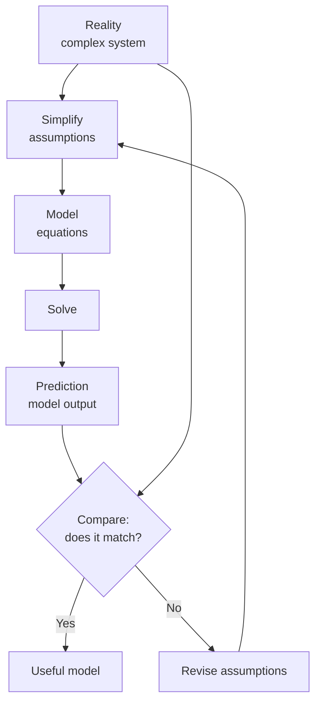

import TawkWidget from '../../../../components/TawkWidget.astro';
import UniversalContentContributors from '../../../../components/UniversalContentContributors.astro';
import InArticleAd from '../../../../components/InArticleAd.astro';
import Copyright from '../../../../components/Copyright.astro';
import BionicText from '../../../../components/BionicText.astro';
import TailwindWrapper from '../../../../components/TailwindWrapper.jsx';
import { Tabs, TabItem } from '@astrojs/starlight/components';
import { Card, CardGrid, Badge, Steps, LinkButton, FileTree } from '@astrojs/starlight/components';

<UniversalContentContributors 
  contributors={frontmatter.contributors}
/>

import PhilosophyOfScienceEngineeringComments from '../../../../components/philosophy-of-science-engineering/PhilosophyOfScienceEngineeringComments.astro';

The maker's curve says that the pump will deliver 5.0 m³/h. In your borehole it delivers 4.0, and the tank that should fill in 12 minutes takes 15. The curve was not false. It answered a question about a new pump on a test bench at a stated lift, and your borehole asked a different question. Every model leaves something out: a pump curve, a heat load calculation, a circuit simulation. This lesson shows you how to find what a model leaves out, and how to decide whether that matters for your decision. #Models #Simulation #Engineering

## The Map Is Not the Territory

Alfred Korzybski coined the phrase "the map is not the territory" in his 1933 book *Science and Sanity*. A map is made for one kind of journey. A road map shows the roads and leaves out the hills, which suits a driver and is useless to someone who must lay a pipe. In the same way, a drawing of a pump station is not the pump station, and a simulation of a bridge is not the bridge.

Nobody confuses a paper map with a city. Engineers confuse models with reality in three less obvious ways.

### Three Levels of Confusion

<Steps>
1. **Forgetting that the model is there.** "The pump delivers 5.0 m³/h." No. The curve says 5.0 m³/h. The pump delivers what the flow meter shows.

2. **Forgetting what the model leaves out.** "The circuit is stable." The simulation says so. The simulation does not contain the stray inductance of your wires or the real behaviour of your capacitors. Does one of these matter?

3. **Forgetting that the model can be wrong.** "The thermal calculation shows that the inverter stays below its limit." The calculation assumes free air around the cabinet. What if the cabinet stands in the sun against a wall?
</Steps>

## All Models Are Wrong, But Some Are Useful

<InArticleAd />

The statistician George Box wrote the best known sentence about models: "All models are wrong, but some are useful." It is not a complaint. It is an instruction for use.

### Why All Models Are Wrong

A model is useful because it is simpler than the thing it describes: one with every detail would be as hard to work with as the real thing. So every model leaves something out, and sometimes that part matters.

| Model | What It Captures | What It Ignores |
|-------|-----------------|-----------------|
| Ohm's law (V = IR) | The straight line between voltage, current and resistance | The change of resistance with temperature and frequency |
| Maker's pump curve | Flow against head for a new pump on a test bench | Wear, the real water level, pipe friction, low supply voltage |
| Cold room heat load calculation | Heat through the walls at a design outdoor temperature | Door openings, warm stock, a dirty condenser |
| Solar yield estimate | Average sunlight and the ratings of the panels | Dust, shade from a new building, a hot roof, faults |
| Circuit simulation (SPICE) | How the components behave together | The layout of the board, interference, the spread between parts, ageing |
| Finite element analysis (FEA) | The stress in a mechanical part | Fatigue, surface finish, flaws from manufacture |

Each of these models is useful and incomplete. Your job is to know which entry in the last column matters for the problem in front of you.

### When "Wrong" Is Good Enough

<Card title="The 5% Rule of Thumb" icon="approve-check">
In much of engineering, a model that predicts reality within 5% is excellent. Whether 5% is good enough depends on the use. For the fill time of a water tank it does not matter. For a dose of medicine it may be dangerous.
</Card>

The question is never "is the model right?" It is not. The question is "is the model accurate enough for this decision?"

Take a model that estimates the daily energy need of a site to within about 10%. It is used to choose a battery on two sites.

| | Site A: lights and phone charging | Site B: a vaccine refrigerator |
|---|---|---|
| The model's estimate of the need | 60% of the battery | 95% of the battery |
| Margin left | 40% | 5% |
| Error of the model | 10% | 10% |
| Decision | Use the model | Measure the real load first |

The model and its accuracy are the same on both sites. On site A the margin is four times the error. On site B the error is twice the margin.

### A worked case: the pump curve and the borehole

A borehole pump was chosen from the maker's curve below. Head is the total height the pump must lift the water, with the friction in the pipe counted as extra height.

| Head (m) | 40 | 50 | 60 | 70 | 80 |
|---|---|---|---|---|---|
| Flow (m³/h) | 6.5 | 5.8 | 5.0 | 4.0 | 2.8 |

<Steps>
1. **Write what the model said.** The designer added the water level, 45 m below the ground, the tank inlet, 13 m above the ground, and 2 m for pipe friction: $45 + 13 + 2 = 60$ m. The curve gives 5.0 m³/h at 60 m.

2. **Compare it with a measurement.** At 5.0 m³/h, which is 5,000 litres an hour, a 1,000 litre tank fills in one fifth of an hour: 12 minutes. It takes 15 minutes. The real flow is $1{,}000 / 15 \times 60 = 4{,}000$ litres an hour, or 4.0 m³/h.

3. **List the assumptions.** The pump is as good as new. The supply voltage is correct. The friction is 2 m. The water level is 45 m.

4. **Find the weakest assumption.** The pump is new and the voltage has been checked. The 45 m was measured with the pump stopped, and the water level in a borehole falls while the pump runs.

5. **Measure it.** With the pump running, a dip meter (a tape that signals when it touches water) shows the level at 55 m.

6. **Run the model again with the measured value.** $55 + 13 + 2 = 70$ m. The curve gives 4.0 m³/h at 70 m, which is the measured flow.
</Steps>

The curve was right. One of its inputs was not. A larger pump chosen with the same 45 m would disappoint in the same way, and pull the water level lower still. The answer of a model is only as good as the weakest value you put into it.

## When Models Work: SPICE Simulation

<InArticleAd />

SPICE is a program that predicts how an electronic circuit will behave before it is built. It was developed at the University of California, Berkeley, in 1973, and it is one of the most successful models in engineering.

### Why SPICE Works Well

<CardGrid>
  <Card title="Physics-Based" icon="approve-check">
    The component models come from the physics of semiconductors, not from curves fitted to a few measurements.
  </Card>

  <Card title="Well-Characterized Devices" icon="approve-check">
    Makers publish SPICE models of their parts, measured on real production devices.
  </Card>

  <Card title="Known Limitations" icon="approve-check">
    What SPICE leaves out is well documented. Knowing what a model ignores is as valuable as knowing what it contains.
  </Card>
</CardGrid>

### Where SPICE Fails

**Layout.** SPICE treats wires as perfect. On a real board every track has a little resistance, capacitance and inductance, and at high frequency these decide the behaviour.

**Tolerance.** SPICE uses the nominal value of each part. A real 10 kohm resistor may be 9.5 kohm or 10.5 kohm. Monte Carlo simulation, which runs the model thousands of times with random part values, shows the spread.

**Temperature.** By default SPICE runs at 27 C. If the product works from minus 40 C to plus 85 C and you did not simulate that range, you have not tested the design.

**Ageing.** The models describe new parts. After 10 years of heat, the values have moved.

## When Models Fail: The 2008 Financial Crisis

<InArticleAd />

The financial crisis of 2008 is a very large example of a model taken for reality.

### The Model

Banks used mathematical models to price bundles of home loans. The models estimated how likely it was that many borrowers in one bundle would stop paying, which is called default.

### The Assumptions

<Steps>
1. **The past is a guide to the future.** The link between one borrower's default and another's was measured on past data and assumed to stay the same.

2. **House prices can fall in one city, but not across the whole country at once.** This had been true for decades, so the models treated it as reliable.

3. **One default has little effect on the next.** In reality, falling prices form a chain: one forced sale lowers the value of the houses near it, more owners then owe more than their house is worth, and more of them default.
</Steps>

### What Went Wrong

All the assumptions failed together. House prices fell across the country, defaults came in a chain, and the links measured in calm years did not hold in the crisis. Bundles that the models rated "AAA", which means almost free of risk, lost 80% to 100% of their value. The models were most wrong in the one situation where accuracy mattered most.

### The Engineering Lesson

<Card title="The Financial Crisis as an Engineering Failure" icon="warning">
The analysts built models, checked them against past data, and then treated the models as reality. An engineer does the same when "the simulation passed" ends the discussion and nobody asks what the simulation left out.
</Card>

**The same pattern in engineering:**
- "The heat load calculation shows that the cold room is large enough", but the calculation assumes a closed door, and the door stands open for much of the working day
- "FEA shows that the bracket carries 500 N", but the model assumes perfect material, and the real casting has a flaw
- "The yield estimate shows that the solar plant will cover the load", but the estimate assumes clean panels and no shade

In each case the model did its work. The failure is human: the answer of the model was taken as reality, when it is one input to a decision.

## Engineering Models and Their Hidden Assumptions

<InArticleAd />

Assumptions are easy to forget once you look at results. Here are three common kinds of model and what each quietly assumes.

### Thermal Models

<Tabs>
<TabItem label="What They Model">
- heat conducted through materials
- heat carried away by moving air
- heat radiated between surfaces
</TabItem>

<TabItem label="Common Hidden Assumptions">
- perfect contact between surfaces
- a constant outdoor temperature, with no hot season
- steady conditions, with no start-up and no change of load
- smooth, free airflow
- no dust on heat sinks and condensers
</TabItem>
</Tabs>

### Circuit Models

<Tabs>
<TabItem label="What They Model">
- the behaviour of each component
- steady voltages, the response to frequency, the response to a sudden change
</TabItem>

<TabItem label="Common Hidden Assumptions">
- perfect connections
- nominal part values
- room temperature
- new parts
- a clean power supply
- no interference from nearby circuits
</TabItem>
</Tabs>

### Pump and Pipe Models

<Tabs>
<TabItem label="What They Model">
- flow against head for the pump
- friction in the pipes
- the height the water must be lifted
</TabItem>

<TabItem label="Common Hidden Assumptions">
- the water level measured at rest stays the same during pumping
- pipes as smooth as new
- full supply voltage at the motor
- clean water with no sand
- a pump as good as the sample the maker tested
</TabItem>
</Tabs>

## How to Use Models Wisely

<InArticleAd />

Models are necessary tools. Use them with five questions.

### The Five Questions

<Steps>
1. **What are the assumptions?** List them. If you cannot, you do not understand the model well enough to trust it.

2. **Which assumption is weakest here?** Rank them by how likely each is to be wrong in your application.

3. **What happens if the weakest one is wrong?** Does the answer become a little less accurate, or meaningless? The financial models became meaningless.

4. **Has the model been compared with reality?** With measurements on real equipment in real conditions, not with another model. Two models that agree may share the same wrong assumption.

5. **What does the model not tell you?** A pump curve says nothing about the water level. A stress analysis says nothing about fatigue. Know the edges of what the model can answer.
</Steps>

### Validation: The Bridge Between Model and Reality

<Card title="The Validation Hierarchy" icon="star">
Validation means comparing a model with reality. It has levels, from weakest to strongest.
</Card>

| Level | Validation Method | Confidence |
|-------|-------------------|------------|
| 1 | Reviewed by the person who built it | Very low |
| 2 | Reviewed by an independent engineer | Low: finds the obvious errors |
| 3 | Compared with another model | Moderate: shows agreement, not accuracy |
| 4 | Compared with published data | Moderate to high: depends on the data |
| 5 | Compared with your own measurements on a prototype | High |
| 6 | Predictions checked in service over time | Highest |

Most engineers stop at level 2 or 3. The models that cause failures are the ones that never reached level 5.

### The Prototype Imperative

<Card title="Rule of Thumb" icon="approve-check">
If the output of a model drives a decision with a high cost or a risk to safety, compare it with a measurement before you commit. "The simulation passed" is necessary and never enough.
</Card>

A model is still the right place to start. It lets you compare many designs cheaply, shows which inputs matter most, and catches large errors before they are built. The final answer comes from a measurement.

## Key Takeaways

<InArticleAd />

<CardGrid>
  <Card title="The Map Is Not the Territory" icon="approve-check">
    Every model simplifies. That is what makes it useful, and what can mislead you.
  </Card>

  <Card title="Know Your Assumptions" icon="star">
    If you cannot list the assumptions in a model, you do not understand it well enough to trust its answer.
  </Card>

  <Card title="Validate Against Reality" icon="approve-check">
    Two models that agree show agreement, not accuracy. Only a measurement on real equipment validates a model.
  </Card>

  <Card title="Models Fail at the Boundaries" icon="warning">
    A model is most accurate in the middle of its range and least accurate at the edges, and failures happen at the edges.
  </Card>
</CardGrid>

### Looking Ahead

A measurement is the judge of a model, but a measurement has limits of its own. The lesson on [uncertainty and the limits of knowledge](/education/philosophy-of-science-engineering/uncertainty-limits-of-knowledge/) covers them: the error in every reading, systems that cannot be predicted far ahead, and how to design when you cannot know everything.

## Exercises

<InArticleAd />

1. **Assumption audit.** Take a model you have used recently: a pump curve, a load calculation, a simulation or a spreadsheet. List every assumption in it. How many had you not thought of before?

2. **Validation gap analysis.** For the same model, which level of the validation hierarchy (1 to 6) has it reached? What would it take to move it one level higher? Is that worth the cost for your use?

3. **The financial crisis parallel.** Find a model in your own work in which several assumptions could fail together for one reason, as the housing assumptions did. What would the answer of the model be worth then?

4. **Prototype vs simulation.** Describe a case in which a model and a measurement disagreed. What had the model left out? What would you do differently now?

5. **The largest simplification.** In one current project, name the one simplification that makes the calculation possible and is most likely to differ from reality. Is it acceptable for your use, or must the model become more detailed?

<PhilosophyOfScienceEngineeringComments />

<InArticleAd />
<TawkWidget />
<Copyright />
