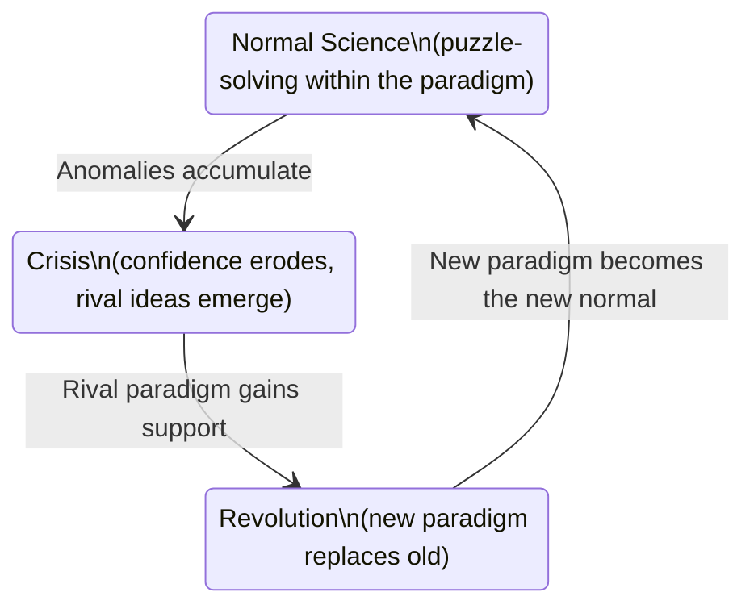

import TawkWidget from '../../../../components/TawkWidget.astro';
import UniversalContentContributors from '../../../../components/UniversalContentContributors.astro';
import InArticleAd from '../../../../components/InArticleAd.astro';
import Copyright from '../../../../components/Copyright.astro';
import BionicText from '../../../../components/BionicText.astro';
import TailwindWrapper from '../../../../components/TailwindWrapper.jsx';
import { Tabs, TabItem } from '@astrojs/starlight/components';
import { Card, CardGrid, Badge, Steps, LinkButton, FileTree } from '@astrojs/starlight/components';

<UniversalContentContributors 
  contributors={frontmatter.contributors}
/>

import PhilosophyOfScienceEngineeringComments from '../../../../components/philosophy-of-science-engineering/PhilosophyOfScienceEngineeringComments.astro';

A factory changes its motor bearings every two years, as it has done since the line was built. This year five bearings failed between changes, and each failure stopped the line. The technicians followed the rule exactly. The rule was the problem: the plant had changed and the rule had not. Thomas Kuhn described how a whole field holds one way of working for years and then gives it up, and the same pattern appears in every plant. This lesson shows you the signs that a trusted method has been outgrown, why good people defend it, and how to test a replacement fairly before you rely on it. #ParadigmShifts #Kuhn #EngineeringHistory

## Kuhn's Model of Scientific Revolutions

Thomas Kuhn (1922 to 1996) published *The Structure of Scientific Revolutions* in 1962. Before it, most people pictured science as a wall built one brick at a time. Kuhn showed that the history looks different: long calm periods, and then a short period in which a field replaces its basic way of working.

He called that basic way of working a **paradigm**. A paradigm is more than one theory or one machine. It is what a group of practitioners share: which problems are worth solving, which methods count as valid, and what a good answer looks like. Because everyone shares it, people stop noticing it. It feels like "how the work is done".

### The Four Phases

<Steps>
1. **Normal science.** People work inside the paradigm and solve the problems it sets. Kuhn called this puzzle-solving. It is productive, and most work in any field is of this kind.

2. **Anomalies collect.** An anomaly is a result that the paradigm cannot explain cleanly. At first each one is set aside. "That is noise in the data." "Your measurement must be wrong."

3. **Crisis.** When the anomalies are too many or too costly to set aside, confidence falls. Rival methods appear. Arguments become sharp, because people have built careers on the old way.

4. **Revolution.** A new paradigm explains the anomalies, and the field moves to it. The new paradigm also changes which problems and which methods count. It replaces the old one and is more than an addition to it.
</Steps>

In a plant the same four phases appear on a smaller scale. The paradigm is the site's settled way of running its equipment. The anomalies are the stops, the complaints and the readings that nobody can explain.

## Engineering Paradigm Shifts

<InArticleAd />

Kuhn wrote about science. His pattern also fits changes of method in engineering. Four cases follow: two from electronics and networks, and two from the daily running of a plant.

### 1. Vacuum Tubes to Transistors (1947 to 1970s)

A vacuum tube is a glass valve that amplifies or switches an electrical signal. Until the 1950s, radios and computers were built from them.

| Phase | What happened |
|-------|---------------|
| Normal science | Tube circuits were well understood and supported by a mature industry of makers, designers and technicians |
| Anomalies | Tubes were large, hot and fragile. The ENIAC computer had 17,468 of them and needed constant maintenance. People treated this as a problem to solve with better tubes |
| Crisis | The transistor, shown at Bell Labs in 1947, did the same work in a small piece of germanium. Early transistors were expensive and unreliable, and many tube engineers dismissed them |
| Revolution | By the middle of the 1960s the transistor had won, and the integrated circuit (1958) made the change permanent. Tubes remained in a few uses, such as some audio amplifiers and high power radio transmitters |

Skilled tube engineers had to retrain or retire. Some of those who resisted were right about particular uses, and wrong about the direction of the field.

### 2. Repair on failure, to the calendar, to condition

The maintenance of machines has changed its paradigm twice.

| Paradigm | The rule | Where it struggles |
|----------|----------|--------------------|
| Repair on failure | Run the machine until it stops, then repair it | Stops come at the worst time and damage other parts |
| Service by the calendar | Change the part at a fixed interval, before it fails | Some parts fail early and stop the line anyway. Others are thrown away with years of life left |
| Service by condition | Measure the machine (vibration, temperature, current) and act when the measurement changes | It needs sensors, records and people who can read them |

Each change also changed what counts as good work. Under the calendar, a good technician does every service on its date. Under condition, a good technician has machines that do not stop without warning.

### 3. The logbook to the continuous record

For generations an operator has walked the plant once a shift and written the readings on a sheet. The method is cheap, and it works for anything that changes slowly.

Its anomalies are events that happen between two rounds. A cold room warms to 9 °C for two hours in the night and is back at 4 °C by the morning round. The sheet shows two good readings, and nobody can explain the spoiled stock. A sensor that records every few minutes shows the event, its time and its length.

The new method changes the question from "what was the reading?" to "what happened between the readings?". It also brings its own problems: sensors that drift, and more alarms than anyone can answer.

### 4. IPv4 to IPv6: a shift that stalled

Every device on the internet needs an address. The old scheme, IPv4, has about 4.3 billion, and in the 1990s it became clear that these would run out. IPv6, standardized in 1998, has far more. But a workaround called NAT (Network Address Translation) lets many devices share one IPv4 address. NAT breaks direct connections between devices and complicates many protocols, and it works well enough for most uses. So the move to IPv6 has taken decades and is not finished.

A shift can stall. When the old paradigm has a workaround that is good enough, the crisis does not come. A plant does the same when a spare motor on the shelf makes repeated failures bearable, and nobody asks why the motors fail.

## Why Paradigm Shifts Are Resisted

<InArticleAd />

People who defend an old method are often called stubborn. Kuhn saw that much of the resistance is reasonable. You need to separate the reasonable part from the rest, in other people and in yourself.

### Rational Reasons for Resistance

<CardGrid>
  <Card title="Existing Expertise" icon="warning">
    A technician with 20 years on one type of equipment has knowledge that loses value when the equipment changes. That is a real loss, and it is fair to weigh it.
  </Card>

  <Card title="Tooling Investment" icon="warning">
    A site has tools, spare parts, procedures and training built for the present method. The cost of changing them is real.
  </Card>

  <Card title="The New Paradigm Is Immature" icon="warning">
    Early transistors were worse than tubes for many uses. A first condition monitoring system gives false alarms. A new method needs time, and during that time caution is partly justified.
  </Card>

  <Card title="The Old Way Works" icon="warning">
    This is the strongest reason. The present method is not broken. It has problems that people have learned to live with. "The calendar has served us for years" is a true statement. The question is whether the conditions that made it true still hold.
  </Card>
</CardGrid>

### Irrational Reasons for Resistance

Other reasons do not survive a close look:

- Identity. "I am a tube engineer" ties a person to the method, so a criticism of the method feels like a criticism of the person.
- Selective evidence. Every failure of the new method is remembered ("the sensor gave a false alarm again") and its successes are not counted.
- A moving target. The new method meets the stated objection, and a different objection takes its place. When this happens three times, the objections were not the real reason.

## The Rust vs C Debate Through Kuhn's Lens

<InArticleAd />

A shift is easiest to study while it is happening. One is in progress now in the software that runs inside machines and controllers.

C has been the main language for this software since the 1970s. The programmer manages the computer's memory by hand, and the paradigm trusts the programmer to do it correctly. The anomaly is a class of faults called memory safety bugs, in which a program reads or writes memory that it should not. Microsoft reports that 70% of CVEs (publicly listed security faults) are memory safety issues.

Rust is a newer language. Its compiler, the program that turns source text into machine code, refuses to build code that contains most of these faults. The discipline moves from the programmer to the tool.

### Where We Are in Kuhn's Model

In Kuhn's terms this is the crisis, or the early revolution. The anomalies are documented and widely accepted. An alternative exists and has been shown to remove them. Resistance is weakening: the Linux kernel now accepts Rust modules. The defenders raise fair objections (the time needed to learn it, tools that are still young) beside unfair ones ("real programmers do not need a compiler to check them").

## Incommensurability

<InArticleAd />

Kuhn's most disputed idea has a long name: **incommensurability**, which means "having no common measure". People in two paradigms can fail to agree on what the problem is, before they reach the question of the solution.

### Engineering Incommensurability

A maintenance supervisor and a reliability engineer discuss the bearings that failed:

- Supervisor: "Every service this year was done on its date. My team did nothing wrong."
- Engineer: "The line stopped five times without warning. The method is failing."
- Supervisor: "Those were bad bearings. The schedule is sound."
- Engineer: "The schedule counts months. Bearings wear by hours."

They do not disagree about the facts. Both accept that the services were done and that the line stopped. They measure success differently: one by services completed on time, the other by stops without warning. More data will not settle the argument until they agree on the measure.

When a technical argument goes in circles, stop and ask each side: "What result would you count as success?"

## Lakatos: Progressive vs Degenerating Programs

<InArticleAd />

Kuhn's model has sudden revolutions. Imre Lakatos (1922 to 1974), a philosopher of science, offered a calmer test that you can apply on any day. He looked at a **research program**: a core idea together with the adjustments made over time to protect it. For engineering, read "method" where he wrote "program".

A **progressive** program keeps producing something new: predictions that prove right, and uses that were impossible before. A **degenerating** program spends its effort on explaining its failures. Each new problem gets a new patch, and the patches predict nothing.

### Applying Lakatos

| Question | Progressive sign | Degenerating sign |
|----------|-----------------|-------------------|
| What changed in this method recently? | New abilities, new uses | Better workarounds for old problems |
| What do new people choose? | They choose this method | They choose something else when they are free to |
| What do its users talk about? | What it makes possible | Why the alternatives are worse |
| What can it do now that it could not do 5 years ago? | Several things | Nothing new |

Be fair with the last row. A mature, stable method with no anomalies is not degenerating. A hammer has not changed for a long time and needs no replacement. The warning sign is the patches, not the age.

## A worked case: the rule the plant outgrew

A factory changes the bearings of its conveyor motors every 24 months. This year 5 bearings failed between changes. Last year 1 did. The manager asks whether to buy better bearings.

<Steps>
1. **Write down the rule and the day it was made.** "Change every 24 months" was set when the line ran one shift: 8 hours a day, 5 days a week.

2. **Find the assumption inside the rule.** Bearings wear with running hours. In the old pattern one year was $8 \times 5 \times 52 = 2{,}080$ hours, so 24 months meant 4,160 running hours. The rule was always a rule about hours, written in months.

3. **Check whether the assumption still holds.** The line now runs two shifts, 6 days a week: $16 \times 6 \times 52 = 4{,}992$ hours a year. Between changes the bearings now run 9,984 hours, which is 2.4 times what the rule intended. They reach 4,160 hours after 10 months.

4. **List the workarounds.** A spare motor now stands beside the line. There is a weekend call list. A note on the panel says "listen to motor 3". Each one makes the failures easier to bear, and none explains them. This is the degenerating sign.

5. **Name the options and what each must show.** Option A: keep the calendar and shorten it to 10 months. This works only until the shift pattern changes again. Option B: count running hours and change at 4,160. Option C: measure vibration every month and change a bearing when its reading rises. Before any trial, write the test: "no failure between changes for six months".

6. **Decide.** Move all the motors to option B now. It costs an hour meter and it restores what the rule intended. Try option C on two motors for six months, and extend it only if it warns of a failure that B would have missed.
</Steps>

The bearings were not the problem. The decision is a modest one: changing parts at a fixed interval stays, with its hidden assumption corrected, and service by condition is tried on a small scale against a result named in advance. A careful site crosses a paradigm shift in this way.

## What This Means for Your Career

<InArticleAd />

You will work through several paradigm shifts, and some will be in the equipment you know best.

### How to Recognize a Paradigm Shift in Progress

<Steps>
1. **Count the workarounds.** When a method needs more and more patches for the same weakness, a shift may be forming. NAT for IPv4. The spare motor beside the line.

2. **Follow the anomalies.** Keep a list of what the present method fails to explain. A new method will be judged on exactly these.

3. **Separate discomfort from danger.** A new method feels uncomfortable because it is new. That feeling is not evidence against it. Judge it on results.
</Steps>

### The Practical Strategy

You do not need to predict which method will win. Build skills that survive a change of tools: fault finding, testing, measuring, clear records. Describe yourself by the problems you solve, not by one tool.

## Key Takeaways

<InArticleAd />

<CardGrid>
  <Card title="Paradigm Shifts Follow a Pattern" icon="approve-check">
    Normal work, anomalies, crisis, revolution. The pattern tells you where a method stands.
  </Card>

  <Card title="Resistance Is Partially Rational" icon="open-book">
    Experience, tools and the weakness of a young method are fair reasons for caution. They are not reasons to stop looking.
  </Card>

  <Card title="Watch for Degenerating Programs" icon="warning">
    Lakatos's test: does the method still produce something new, or only patches for its failures?
  </Card>

  <Card title="Stay Adaptable" icon="star">
    Write down the assumption inside each rule you rely on, and check it when the plant changes. Try a new method on a small scale, against a result you named in advance.
  </Card>
</CardGrid>

### Looking Ahead

A paradigm is one kind of model, and every model leaves something out. The lesson on [models, maps and reality](/education/philosophy-of-science-engineering/models-maps-reality/) examines that gap.

## Exercises

<InArticleAd />

1. **Paradigm shift mapping.** Choose a change of method that you have lived through, or one from your field. Map it onto Kuhn's four phases. Where is it now? Which anomalies drove it?

2. **Lakatos evaluation.** Pick two competing methods in your field (two maintenance strategies, two programming languages, two communication protocols). Is each one progressive or degenerating? What evidence supports your answer?

3. **Incommensurability detection.** Recall a technical argument at work that went in circles. Write down what each side counted as success. Did they share a measure?

4. **Rule audit.** List three rules of thumb that your site follows. For each one, write when it was made, what it assumes, and whether the assumption still holds.

<PhilosophyOfScienceEngineeringComments />

<InArticleAd />
<TawkWidget />
<Copyright />
