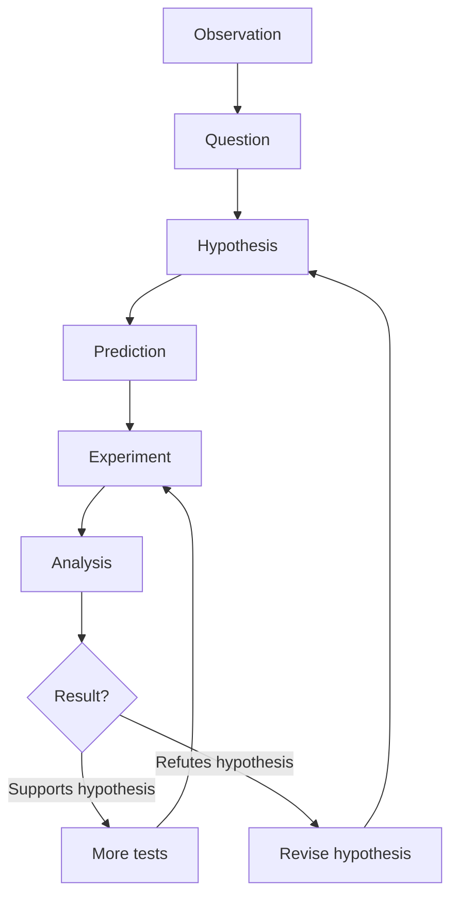
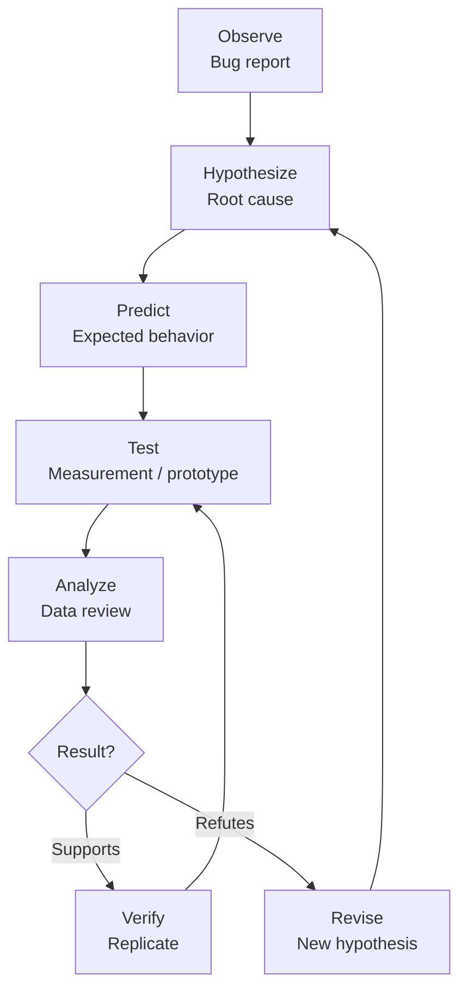

import TawkWidget from '../../../../components/TawkWidget.astro';
import UniversalContentContributors from '../../../../components/UniversalContentContributors.astro';
import InArticleAd from '../../../../components/InArticleAd.astro';
import Copyright from '../../../../components/Copyright.astro';
import BionicText from '../../../../components/BionicText.astro';
import TailwindWrapper from '../../../../components/TailwindWrapper.jsx';
import { Tabs, TabItem } from '@astrojs/starlight/components';
import { Card, CardGrid, Badge, Steps, LinkButton, FileTree } from '@astrojs/starlight/components';

<UniversalContentContributors 
  contributors={frontmatter.contributors}
/>

import PhilosophyOfScienceEngineeringComments from '../../../../components/philosophy-of-science-engineering/PhilosophyOfScienceEngineeringComments.astro';

A solar plant's output falls. In one visit a technician washes the panels, tightens a loose connector and restarts the inverter (the unit that converts the panels' output for the mains). The output returns, and nobody knows which of the three actions did it. Three weeks later the output falls again, and the work starts from nothing. The scientific method prevents this: guess the cause, say what you should see if the guess is right, test one thing, and write it down. This lesson shows the method as engineers use it for fault finding, tests and records. #ScientificMethod #Engineering #HypothesisTesting

## The Textbook Version

School teaches the scientific method as a fixed line of steps:

A hypothesis is a guess at an explanation, stated so that it can be tested. The model is correct in what it contains, but too tidy, in ways that can mislead you.

### What the Textbook Gets Right

<CardGrid>
  <Card title="Hypotheses Must Be Testable" icon="approve-check">
    You cannot only assert that a repair worked. Make a prediction that could fail, then test it.
  </Card>

  <Card title="Evidence Trumps Authority" icon="approve-check">
    It does not matter who designed the system. If the meter shows that the pump draws 14 A, it draws 14 A. Data outranks opinion.
  </Card>

  <Card title="Iteration Is Built In" icon="approve-check">
    The arrow from "refutes hypothesis" back to "revise hypothesis" is the most important one in the diagram. A wrong guess that is caught moves you forward.
  </Card>
</CardGrid>

### What the Textbook Gets Wrong

Real work does not follow the steps in order, one at a time.

**What you see depends on what you know.** An experienced technician hears a worn bearing that a beginner does not notice. Your knowledge decides what you observe.

**A hypothesis often starts as a hunch.** Many good ideas began with a guess or a comparison, not with careful observation. Where an idea comes from does not matter. Whether it survives a test does.

**Several hypotheses compete.** The diagram shows one. In practice you hold three or four possible causes and look for the test that separates them.

**The path bends.** You may start to test before the hypothesis is clear, and a test may show something that sends you another way. The tidy arrows are drawn afterwards.

## Engineering IS Applied Scientific Method

<InArticleAd />

Engineers use the scientific method every day under other names. The next diagram is the first one with the names changed.

### The Translation Table

| Scientific Method | Engineering Practice | What It Looks Like |
|-------------------|---------------------|-------------------|
| Observation | Fault report, complaint from the site | "The standby generator fails to start about one time in ten" |
| Hypothesis | A guess at the root cause | "The battery voltage is too low on cold mornings" |
| Prediction | What you should see if the guess is right | "Then the failed starts will fall on the mornings with the lowest battery voltage" |
| Experiment | Test, measurement, prototype | Record the battery voltage and the result at every weekly test start for two months |
| Analysis | Review of the data | The failures came at the lowest voltages. Or did they come on the days when a different person ran the test? |
| Peer review | Design review | "Did you also check the fuel valve?" |
| Replication | Independent check | A second technician repeats the test on the sister unit |
| Publication | Report, maintenance log | Write the cause and the repair in the log |

## Debugging as Hypothesis Testing

<InArticleAd />

Debugging means finding the cause of a fault. The word comes from software, but the work is the same on a pump or a production line: a system does not behave as expected, and you must find out why.

### A Systematic Debugging Process

<Steps>
1. **Observe the symptom exactly.** Not "it does not work". What happens? When? Under which conditions? Can you make it happen? A vague observation gives a vague hypothesis.

2. **Form several hypotheses.** List at least three possible causes. With only one, you are guessing.

3. **Rank them.** Which is most likely from what you know? Which can you test fastest? Start with a cause that is both likely and quick to test.

4. **Design a test that separates them.** The best test gives one result if hypothesis A is right and another if hypothesis B is right. "If the mains supply is the problem, the fault will disappear when we run from the generator."

5. **Change one variable at a time.** If you change three things and the fault goes, you do not know which change removed it.

6. **Record everything.** What you tested, what you saw, what you concluded. The notebook or the maintenance log is your scientific record.
</Steps>

### The One-Variable Rule

This rule is broken most often when time is short.

<Card title="The One-Variable Problem" icon="warning">
"I washed the panels and the output came back." Did you also tighten a connector? Did the inverter restart? Was the afternoon clearer than the morning?
</Card>

Changes made together are **confounding variables**: you cannot separate their effects. The results are familiar:

- "repairs" that repaired nothing
- sound parts replaced at a cost
- rituals with no reason ("always switch it off twice")
- hours lost when the fault returns, because the real cause was never found

Changing one thing at a time feels slow. It is faster, because each test gives an answer.

### A worked case: the solar plant that lost an eighth

A solar plant has 8 strings (rows of panels wired in series). In the same month last year it produced 600 kWh a day. This year it produces 516 kWh a day, which is 14% less.

<Steps>
1. **Observe exactly.** The output is low every day, not only on cloudy days, and the fall began within one week.

2. **List the hypotheses.** A: there is less sunlight this year. B: the panels are dirty. C: one string has stopped.

3. **Say what each one predicts.** A: the sunlight sensor on the site reads about 14% lower. B: every string gives a little less current. C: one string gives no current and seven are normal, so the output for each unit of sunlight is lower by one eighth, 12.5%.

4. **Test A first, because the data exist.** The sensor shows 5.7 kWh/m² a day last year and 5.6 this year, which is 1.8% less. Last year the plant gave $600 / 5.7 = 105.3$ kWh for each unit of sunlight. This year it gives $516 / 5.6 = 92.1$, which is 12.5% lower. Sunlight explains a small part, so A is refuted as the main cause.

5. **Choose the test that separates B from C.** Read the current of each string on the inverter's display at midday. Seven strings give about 8 A each. One gives 0 A. C predicted this, and it contradicts B.

6. **Repair one thing and check the prediction.** An electrician finds a burnt connector on the dead string and replaces it. Nothing else is touched. The output for each unit of sunlight should return to about 105 kWh, and it does.
</Steps>

Nobody washed the panels. They may be dirty as well, but that is a separate question with its own test: wash one string and compare it with the string beside it.

## Controlled Experiments in Engineering

<InArticleAd />

A controlled experiment compares a change with a **control**: the same system without the change, under the same conditions. Without the control you have a number and nothing to compare it with.

### A/B testing a change on a production line

A packing line jams several times in a shift. You fit a new guide rail and want to know whether it helps.

<Tabs>
<TabItem label="Uncontrolled (Bad)">

1. Fit the new guide rail.
2. Run one shift of 8 hours.
3. Count 2 jams.
4. Conclude: "Only 2 jams, so the new rail is better."

How many jams would the old rail have given in the same shift, with the same product? You do not know. There is no baseline.

</TabItem>

<TabItem label="Controlled (Good)">

1. Run a shift of 8 hours with the old rail and count: 7 jams. This is the baseline.
2. Fit the new rail and change nothing else.
3. Run a shift with the same product, speed and crew: 2 jams.
4. Repeat each case three times, on alternate days.
5. Average: 6.3 jams a shift with the old rail and 1.7 with the new one.
6. Conclude: the new rail reduces jams by about 73%.

</TabItem>
</Tabs>

The controlled version takes six shifts in place of one. It gives an answer where the other gives an impression.

### Sensor Calibration as Experiment

Calibration is a controlled experiment that many technicians already run:

| Step | Scientific Method | Sensor Calibration |
|------|------------------|--------------------|
| 1 | Known standard | A reference instrument with its own calibration record |
| 2 | Hypothesis | "Our sensor reads 2% high over the whole range" |
| 3 | Controlled conditions | Stable temperature, no vibration |
| 4 | Repeated measurement | 10 readings at each calibration point |
| 5 | Analysis | The mean, the spread and the uncertainty at each point |
| 6 | Record | A calibration record with the conditions and the results |

If you have calibrated a sensor, you have run an experiment. The question is how carefully.

## Reproducibility: The Engineer's Obligation

<InArticleAd />

A result that nobody else can repeat is not established.

### What Reproducibility Means for Engineers

**Can a competent colleague get the same result from your records alone?** Give them the drawings, the settings, the test procedure and the parts list. If they cannot build the same thing and measure the same performance, something is missing:

<CardGrid>
  <Card title="Implicit Knowledge" icon="warning">
    "You have to hold the reset button while it powers up. I forgot to say." A step that is not written down cannot be repeated.
  </Card>

  <Card title="Environment Dependencies" icon="warning">
    "It works at our site." Supply voltage, water quality, software version, hardware revision. If these are not stated, a repeat depends on luck.
  </Card>

  <Card title="Measurement Ambiguity" icon="warning">
    "Measure the pressure." Where? With which gauge? With the pump running or stopped? An unclear procedure gives unclear results.
  </Card>

  <Card title="Selection Bias" icon="warning">
    "Here are the test results", with only the good runs shown. Without the failed runs, nobody can tell the real success rate.
  </Card>
</CardGrid>

### Documentation as Scientific Record

Your records do the work of a scientist's notebook. Good records include:

- **Exact versions.** Software, hardware revision, model and serial number of the test instruments.
- **Complete procedures.** Steps that a person who has never seen your setup can follow.
- **Raw data.** The measurements, not only the conclusion, and the failed attempts as well.
- **Conditions.** Temperature, supply voltage, load, and anything else that could change the result.
- **Known limits.** What you did not test and what you assumed.

## Case Study: Edison and the Filament

<InArticleAd />

Thomas Edison's search for a lamp filament, from 1878 to 1880, shows the method at the scale of a whole laboratory. A filament is the thin thread inside a lamp that glows when current passes through it.

### The Problem

The filament had to glow at more than 2000 degrees Celsius, last for hundreds of hours, and be cheap enough to sell.

### The Method

<Steps>
1. **Many hypotheses.** Edison's team tested a very large number of materials, among them platinum, carbon and bamboo. Each one was a hypothesis: "This material will make a lasting filament."

2. **Controlled conditions.** Every filament was tested in the same vacuum apparatus, at the same current, by the same procedure, so that the materials could be compared.

3. **Records.** The laboratory notebooks hold the material, its preparation, the voltage, the current, the time to failure and the kind of failure.

4. **Refinement.** When carbonized bamboo did well, the team tested bamboo of other species, from other regions, prepared in other ways.
</Steps>

### What Edison Got Right

A failed filament was not lost time. It removed one hypothesis, and because every test was recorded, no failure had to be repeated.

### What Edison Got Wrong

For power distribution, Edison held to direct current (DC) against the alternating current (AC) of his rival Westinghouse. He ignored the evidence that AC was better for sending power over long distances, and he defended his position with misleading public demonstrations. This is confirmation bias: looking only for the evidence that supports what you already believe.

## The Method Behind the Method

<InArticleAd />

The scientific method is not a recipe. It is a small set of rules: make claims that can be tested, test them hard, change one variable at a time, record everything, and let the evidence decide.

### Key Takeaways

1. **Real investigation is not a straight line.** It loops, branches, and uses hunches as well as system.

2. **Engineering already uses the method.** Fault finding, testing, calibration and design review are forms of it.

3. **Change one variable at a time.** Otherwise a result cannot be traced to its cause.

4. **A result needs records.** If a colleague cannot repeat your result from your records, the work is not finished.

5. **Failure is data.** A failed test teaches you something only if you record what happened and why.

### Looking Ahead

The lesson on [falsifiability](/education/philosophy-of-science-engineering/falsifiability-testing-failure/) asks what a test is for: to confirm that a design works, or to find how it fails? It also returns to confirmation bias. The answer changes how you write a test plan.

## Exercises

<InArticleAd />

1. **Fault log analysis.** Take a fault you found recently, or one that your team recorded. Match each step to the scientific method diagram. Where did you skip a step? Where did you change several things at once?

2. **Reproducibility audit.** Choose one of your own projects or installations. Could a colleague repeat it from your records alone, without asking you anything? List what is missing.

3. **Controlled experiment design.** You suspect that a borehole pump trips more often when the site runs on the generator than when it runs on mains supply. Design a controlled experiment. State the control, the changed condition, what you measure, how many trials you need, and what result would settle the question.

4. **Edison's method.** You must choose a grease for the bearings of a conveyor. Design a test in the manner of Edison's filament search. Which greases will you test? What will you measure? Which conditions will you hold the same?

<PhilosophyOfScienceEngineeringComments />

<InArticleAd />
<TawkWidget />
<Copyright />
