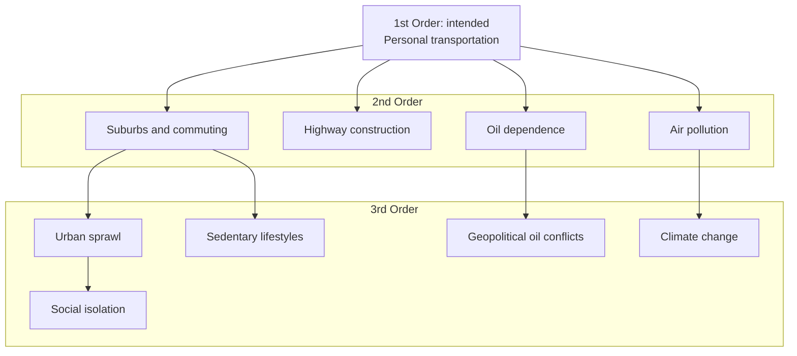

import TawkWidget from '../../../../components/TawkWidget.astro';
import UniversalContentContributors from '../../../../components/UniversalContentContributors.astro';
import InArticleAd from '../../../../components/InArticleAd.astro';
import Copyright from '../../../../components/Copyright.astro';
import BionicText from '../../../../components/BionicText.astro';
import TailwindWrapper from '../../../../components/TailwindWrapper.jsx';
import { Tabs, TabItem } from '@astrojs/starlight/components';
import { Card, CardGrid, Badge, Steps, LinkButton, FileTree } from '@astrojs/starlight/components';

<UniversalContentContributors 
  contributors={frontmatter.contributors}
/>

import PhilosophyOfScienceEngineeringComments from '../../../../components/philosophy-of-science-engineering/PhilosophyOfScienceEngineeringComments.astro';

After a cold room loses its stock one weekend, the owner fits an alarm. Two months later the alarm sends about forty messages a week, the night guard has stopped reading them, and the daily check with a thermometer has ended because "the system watches now". The room is less protected than before. Every technology does more than the thing it was built for: it changes how people behave, and those changes cause further changes. This lesson gives you a way to ask "and then what?" before you install something, and ways to build so that you can correct what you could not foresee. #Technology #UnintendedConsequences #ResponsibleInnovation

## The Cascade of Consequences

The effects of a technology arrive in layers, called orders.

<Card title="Orders of Effect" icon="information">
First-order effects are what the technology is built to do. Second-order effects come when people change their behavior because of it. Third-order effects are changes to a whole system, such as a site, a market or a society, that follow from those changes. Engineers design the first order. They need to think about the second and the third.
</Card>

Each order is harder to predict and harder to reverse.

### The Automobile: A Complete Case Study

The automobile has had more than a century to show all three orders. Its makers solved a transport problem, and people used the car to live far from work. Suburbs, highways, dependence on oil and polluted air in cities followed, and from those came urban sprawl, conflicts over oil, less walking and a warmer climate.

The first engineers intended none of this and could have prevented little of it. The science of greenhouse gases was barely understood in the early 1900s, and the suburbs were driven as much by government policy (highway funding, mortgage subsidies) as by the car. So the point is not that they should have stopped. Consequences reach far beyond the purpose, and the habit of asking "and then what?" is worth having even when the answer is uncertain.

### The Path Dependence Problem

Once many people use a technology, they build equipment, habits and rules around it, and these make a change expensive. This is path dependence: early decisions limit later ones.

The QWERTY keyboard layout was designed in the 1870s partly to prevent jamming on mechanical typewriters. The typewriters are gone, and the layout remains because billions of people have learned it.

A plant meets the same thing on a small scale. The first controller, the first brand of sensor and the first data format are chosen quickly, for one machine. Ten years later every spare part, every drawing and every technician's training depends on them. Early choices deserve more thought than their size suggests.

## Modern Examples

<InArticleAd />

The car took a century. On a site, the second and third orders can arrive within months.

### A monitoring system

<Tabs>
<TabItem label="Intended Purpose">
A factory fits sensors to its machines. The owner sees running hours, stops and temperatures on a phone. Faults are found earlier, and the record shows what happened in the night. These are real gains.
</TabItem>
<TabItem label="Second-Order Effects">
People change what they do.

- The technician's daily round ends, because "the system watches now". The sensors watch only what they measure, and nobody now notices the oil on the floor.
- Operators learn which number the owner looks at. If it is stopped time, a machine is restarted quickly and the cause of the stop is left for later.
- The owner visits less often.
</TabItem>
<TabItem label="Third-Order Effects">
The site changes.

- Skill fades. After some years nobody can judge a machine by its sound.
- The site depends on the network. When the connection is down for two days, nobody is watching and nobody knows it.
- The records find a new use, such as judging the staff. Operators who feel watched learn to defeat the sensors.
</TabItem>
</Tabs>

None of these is a reason to avoid monitoring. Each is a reason to plan for it: keep a shorter round, choose the displayed number with care, and tell people how the records will be used.

### IoT Sensors

<CardGrid>
  <Card title="Intended Purpose" icon="information">
    Connected sensors are fitted for efficiency. A thermostat saves energy, a vibration sensor warns of a failing bearing, a soil sensor saves water.
  </Card>
  <Card title="Unintended Consequence" icon="warning">
    The data grows in value and in risk as it collects. One day of door openings is dull. A year of them shows who works carefully and who does not, and can be asked for in a dispute.
  </Card>
</CardGrid>

"Function creep" is the name for a system that is built for one purpose and used, one small step at a time, for others. Security cameras fitted against theft are later used to time the staff's breaks. Each step seems reasonable, and the result is something that nobody approved. Before you install, ask what else the data could be used for and who might ask for it.

### The number you choose to improve

Any system that is tuned toward one number is shaped by that number, and so are the people around it. A video service tuned for "time spent watching" recommends whatever keeps people watching, which is often content that provokes anger or fear. Tuned for "satisfaction a day later", it would recommend different things.

The same happens on a site:

- A team judged on "alarms per month" widens the alarm limits.
- A pump operator judged on energy used runs the pump less, and the tank runs low.
- A store judged on "average temperature" passes with a room that is too warm every afternoon and very cold every night.

The choice of the number is not neutral. It is a decision about what matters, written into the system.

### Cheap Microcontrollers

A microcontroller is the small computer inside a sensor or a controller. One such as the ESP32 now costs 2 to 3 USD, and that low price has two lists of effects.

Gains:

- People can learn and build electronics with little money.
- A small company can make a hardware product.
- A farmer can measure soil moisture with a sensor that costs 3 USD.

Costs:

- Billions of devices are made with short lives and no path to recycling or repair.
- Cheap connected devices are often sold with default passwords and no means of updating them.
- The minerals in them (tin, tantalum, tungsten, gold) come from mining with significant environmental and human rights concerns.

### The Rebound Effect

The rebound effect, sometimes called the Jevons paradox, is a pattern in which an improvement in efficiency leads to more total use.

When LED lighting replaced incandescent bulbs, the cost of light fell and people installed more light. The energy for each lamp dropped. The total energy used for lighting has not dropped in proportion.

| Technology | Efficiency gain | Rebound effect |
|-----------|----------------|----------------|
| Solar water pump | Pumping costs almost nothing per day | More land is irrigated, and the level in the borehole falls |
| Fuel-efficient engines | Less fuel per kilometer | People drive more, and vehicles get larger |
| Energy-efficient buildings | Less energy per square meter | Buildings get larger |
| Data compression | Less storage per file | People store more data |

Efficiency alone does not reduce consumption. If you promise a saving, measure the total after the change, not only the efficiency.

### Technology Transfer and Context

A design carries the assumptions of the place where it was made. A control system designed for a stable grid, spare parts in the same city and trained staff behaves differently on a site with daily power cuts, parts three weeks away and one operator. Ask which assumptions about the first place are built into the design, and which of them hold in the new place.

## A worked case: the alarm that was silenced

A cold room must stay below 5 °C. After a loss of stock, the owner fits an alarm that sends a message to the night guard's phone whenever the air goes above 5 °C.

<Steps>
1. **Write the first order.** A person knows within minutes that the room is warm.

2. **Ask "and then what?" about an ordinary day.** The room defrosts 4 times a day, and each defrost takes the air above 5 °C for about 20 minutes. Stock is loaded twice a day with the door open. That is 6 messages a day, or 42 a week, with no fault.

3. **Ask it again, about the people.** A real fault comes perhaps once in two months. In that time the guard receives $42 \times 8 = 336$ messages that mean nothing. He stops reading them, and then he turns off the sound.

4. **Ask it once more, about the site.** The owner believes that the room is protected and ends the daily check with a thermometer. The room now has no daily check and an alarm that nobody reads. It is less protected than before.

5. **List the options.** Remove the alarm. Leave it as it is. Or change it so that a message means a fault: send it only when the air has been above 5 °C for 30 minutes, which is longer than any defrost or loading.

6. **Decide, and keep the decision open.** Set the 30 minute delay. Keep one thermometer check a day. Count the messages each week: more than one or two without a fault means that the setting needs another change.
</Steps>

The alarm was not the mistake. The mistake was to stop at the first order. Step 6 matters as much as step 5: the delay is a setting that can be changed, and the weekly count shows whether it should be.

## The Collingridge Dilemma

<InArticleAd />

In 1980, David Collingridge described a difficulty in governing technology that now bears his name:

<Card title="The Collingridge Dilemma" icon="warning">
When a technology is new, its effects cannot be predicted, because it is not yet widely used. By the time the effects are clear, the technology is fixed in habits, investments and equipment, and it is very hard to change.
</Card>

### The Dilemma in Action

Social media appeared in the mid-2000s. Its effects on public debate and on mental health were unknown, so nobody knew what to regulate, although changes would have been technically easy. By the 2020s the effects were well documented. But billions of people now depended on the platforms for news, business and contact, and any change met fixed business models and habits.

A site meets the same dilemma with every new system. In the first month you can change anything, and you do not yet know what to change. In the fifth year you know exactly, and every report, habit and contract depends on the system as it is.

The dilemma is real, but it is not a reason to do nothing. There are steps between the two ends:

| Strategy | Description | Example |
|----------|-------------|---------|
| Monitoring | Watch the effects as use grows | Count the alarms each week, and how many were acted on |
| Reversibility | Design so that behavior can be changed after installation | Alarm limits and delays as settings, firmware that can be updated remotely |
| Modularity | Build so that one part can be replaced | A sensor that can be changed without changing the controller |
| Sunset provisions | Plan the end of life in the first design | The cost of removal and recycling included in the price |

## Responsible Innovation

<InArticleAd />

Responsible Research and Innovation (RRI) is a framework that came from European science policy in the 2010s. It has four parts.

### Anticipate

Ask about effects beyond the purpose. You cannot be certain, but you can be systematic:

- Who will use this, apart from the intended users?
- What could go wrong, including misuse?
- Who gains and who pays? They are often different people.
- What happens at scale? An effect that is small with 100 units can be large with a million.

### Reflect

Examine your own assumptions:

- Which number are you improving, and is it the right one?
- Whose view is missing? If nobody who will operate the system is in the room, you are missing something.
- Who gains power from this, and who loses it?

### Engage

Involve the people who will be affected, above all those who are not in the room:

<CardGrid>
  <Card title="Users" icon="information">
    The operators and technicians, including the reluctant ones, and people who are affected without choosing the product.
  </Card>
  <Card title="Communities" icon="information">
    People who live near the place where the technology is made, used or thrown away.
  </Card>
  <Card title="Regulators" icon="information">
    Talk to them early. A regulation is not only an obstacle to pass.
  </Card>
  <Card title="Future Generations" icon="information">
    Decisions about land, water and infrastructure limit the choices of people decades from now.
  </Card>
</CardGrid>

### Act

Use what you learned to change the design, its installation or its rules:

- change the design to reduce the risks you found
- measure, so that unexpected effects are seen early
- give a named person the duty to review them
- build in the means to correct the course

### Historical Examples of Responsible Innovation

Some technologies were developed with real attention to their effects.

**Seat belts.** Nils Bohlin at Volvo invented the three-point seat belt in 1959. Volvo made the patent available to all manufacturers for free. The three-point belt has saved an estimated one million lives worldwide.

**The Montreal Protocol.** When scientists discovered that chlorofluorocarbons (CFCs), gases used in refrigeration, were destroying the ozone layer, engineers in the chemical and refrigeration industries developed alternative compounds. The Montreal Protocol (1987) phased out CFCs globally, and the ozone layer is recovering.

## What Individual Engineers Can Do

<InArticleAd />

You are one person on one project. That is still enough to change what is built.

### Think Beyond the Spec

The specification says what the product must do. It rarely says what the product must not do, or what it will do in hands that nobody planned for. Four questions help:

<Steps>
1. **Who else might use this?** A location tracker made for delivery vehicles can be used to follow a person.
2. **What happens at scale?** A device that is harmless as one unit can be a waste problem as a million units.
3. **What happens in 10 years?** The data you collect today may be requested in a dispute in 2036. The protocol you choose today may still be running in 2046.
4. **"And then what?"** For every consequence you find, ask what follows from it.
</Steps>

### Consider Who Is Affected

The people who gain from a technology are often not the people who pay for it:

| Technology | Who gains | Who pays |
|-----------|----------------------|---------------------|
| Remote monitoring of a plant | The owner, who can see everything | Operators, whose actions are now recorded |
| A solar pump on a shared aquifer | The farm that pumps more | Neighbors whose wells fall |
| Ride-sharing apps | Urban professionals, investors | Taxi drivers who lose livelihoods, drivers who lack benefits |
| Fast fashion e-commerce | Consumers in wealthy countries | Garment workers, communities near textile factories |

You may not be able to change who pays. You can make them visible in the design.

### Advocate Within Your Organization

<Steps>
1. **Raise the question early.** An effect is cheap to address in the design and expensive after installation.
2. **Bring data as well as values.** "This could be a privacy problem" is easy to dismiss. "This stores GPS positions that show where each driver lives" is harder to dismiss.
3. **Propose an alternative.** "We should not do this" ends the discussion. "We can reach the same goal with Y, which avoids Z" continues it.
4. **Find allies.** You are probably not the only person with the concern.
5. **Write your concern down.** If you are overruled, the record informs the next decision.
</Steps>

### Ask the Right Questions in Design Reviews

Add three questions to every design review:

1. What is the worst thing that someone could do with this?
2. What data does it create, and where does the data go?
3. What happens at the end of its life? Can it be repaired or recycled?

### Build Reversibility into Your Designs

If you cannot predict every consequence, make it possible to respond when one appears.

<CardGrid>
  <Card title="Firmware Updates" icon="approve">
    A connected device that can be updated remotely can be corrected after installation. One that cannot is fixed in its first design, faults included.
  </Card>
  <Card title="Configurable Parameters" icon="approve">
    Make limits, delays and sampling rates into settings, not fixed values in the code. The alarm delay in the worked case can be changed in a minute.
  </Card>
  <Card title="Modular Architecture" icon="approve">
    Design so that one part can be replaced without rebuilding the rest.
  </Card>
  <Card title="Data Retention Policies" icon="approve">
    Decide in advance how long data is kept, and delete it automatically. Data that does not exist cannot be misused or stolen.
  </Card>
</CardGrid>

Reversibility has a cost: more parts, and more settings to manage. It is the price of being able to act on what you learn. Buildings have access panels and bridges have inspection points for the same reason.

## You Cannot Predict Everything

<InArticleAd />

This lesson does not ask you to predict every effect of your work. Nobody can. The inventors of the automobile could not have foreseen climate change.

<Card title="The Real Message" icon="approve">
You cannot predict everything. You can ask the question. You can bring in the people who will live with the result. You can build systems that can be watched, changed and reversed. And you can take responsibility for the consequences that could be foreseen, even when they were not in the specification.
</Card>

### A Framework for Consequence Mapping

For any significant change, fill in this table:

| Question | First order | Second order | Third order |
|----------|-------------|--------------|-------------|
| What does it do? | Its direct function | How people change their behavior | How the site or the society changes |
| Who benefits? | Intended users | People nearby | Those who gain power or advantage |
| Who is harmed? | Nobody, ideally | Those displaced or disadvantaged | Vulnerable people, ecosystems |
| What data is created? | The specified data | Patterns of behavior | Profiles of people |
| What happens at end of life? | The device is discarded | Materials enter the waste stream | Waste collects over the years |

The table will not catch everything. Share it with your team and ask them to add the rows that you missed.

## Exercises

<InArticleAd />

1. Choose a technology that your site adopted in the last five years (a monitoring system, a new machine, a messaging group for the shift). Map its first, second and third-order effects. Which of them did anyone foresee?

2. Research the history of leaded gasoline. Thomas Midgley Jr. invented tetraethyl lead as a gasoline additive in 1921. Map the cascade: the intended effect (reduced engine knock), the second-order effects (lead pollution, health impacts), and the third-order effects (regulatory battles, phaseout, lasting contamination). How long did it take for the harm to be recognized and addressed?

3. Apply the four parts of Responsible Innovation (anticipate, reflect, engage, act) to something you are working on. Write half a page for each part, and say where your analysis is weak.

4. Your site is about to install a system that nobody there has used before. With the Collingridge dilemma in mind, list what you would make changeable, what you would measure in the first three months, and the date on which you would review it.

## Summary

<InArticleAd />

A technology does more than its purpose. People change their behavior because of it (the second order), and the site or the society changes as a result (the third). An alarm can leave a room less protected, an efficient pump can empty a borehole, and a monitoring system can end the daily round. The Collingridge dilemma says that the effects are unknown while change is easy, and known when change is hard. The practical answers are to ask "and then what?" before you install, to choose with care the number you improve, to measure after the change, and to build so that settings, parts and decisions can be reversed.

<PhilosophyOfScienceEngineeringComments />

<InArticleAd />
<TawkWidget />
<Copyright />
