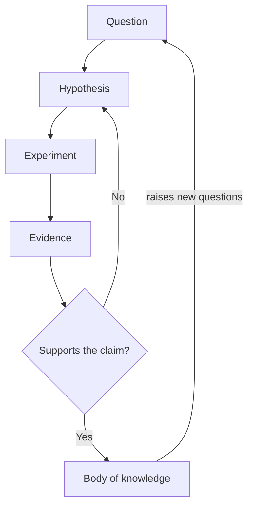

import TawkWidget from '../../../../components/TawkWidget.astro';
import UniversalContentContributors from '../../../../components/UniversalContentContributors.astro';
import InArticleAd from '../../../../components/InArticleAd.astro';
import Copyright from '../../../../components/Copyright.astro';
import BionicText from '../../../../components/BionicText.astro';
import TailwindWrapper from '../../../../components/TailwindWrapper.jsx';
import { Tabs, TabItem } from '@astrojs/starlight/components';
import { Card, CardGrid, Badge, Steps, LinkButton, FileTree } from '@astrojs/starlight/components';

<UniversalContentContributors 
  contributors={frontmatter.contributors}
/>


import PhilosophyOfScienceEngineeringComments from '../../../../components/philosophy-of-science-engineering/PhilosophyOfScienceEngineeringComments.astro';

A supplier offers a controller that "optimises the efficiency" of your cold room. You pay for it. Three months later the electricity bill is the same, and the supplier says the bill would have been higher without the controller. You cannot show that this is false, and that is the problem: a claim that no reading can contradict tells you nothing before you buy and nothing after. This lesson gives you one question that separates a claim you can check from a claim that only sounds technical: what result would show that it is wrong? #PhilosophyOfScience #Falsifiability #CriticalThinking

## What Science Is

Science is two things: a **process** for finding how nature behaves, and the **body of knowledge** it has built. Each feeds the other: a result that survives checking becomes knowledge, and knowledge raises the next question.



The loop never closes. The body of knowledge is the best account we have today, and a result stays in it only while the evidence supports it.

Engineering is an applied science. It uses the knowledge of physics and chemistry to solve real problems, and it is held to the same standard of evidence: a pump delivers its stated flow on the meter or it does not.

## The Hallmarks of Scientific Knowledge

<InArticleAd />


Scientific knowledge has seven marks. No single one defines science. Use them together as a checklist when a claim asks for your trust.

| Hallmark | What it means | What it looks like in engineering |
|----------|---------------|-----------------------------------|
| Empirical | Claims rest on observation and measurement, not on authority | A pump's flow shown by a meter reading, not by "trust me" |
| Falsifiable | Some possible result would show that the claim is wrong | A cold room specification that names the temperature that counts as a failure |
| Reproducible | Other people, in other places, get the same result | If only the supplier's own test shows the saving, it is not established |
| Objective | The result does not depend on who looks | A calibrated meter reading, not "it feels cooler" |
| Rational | The claim does not contradict itself | A model whose assumptions agree with each other |
| Tentative | Conclusions give way to better evidence | A new datasheet revision replaces the old one |
| Predictive | The claim states results that nobody has observed yet | A solar yield estimate made before the plant is built, then compared with the meter |

<Card title="The core discipline of science" icon="star">
In science you change your beliefs to fit the evidence. You do not bend the evidence to fit your beliefs. Each hallmark above is a way to enforce that one rule.
</Card>

Two practices protect these hallmarks. **Peer review** means that independent people examine a claim before it is trusted. A design review does the same work in engineering. **Prediction** is the hardest test. Anyone can explain yesterday's reading. A claim that says what tomorrow's meter will show can be shown wrong, because nature decides the result.

## The Demarcation Problem

<InArticleAd />


Philosophers call it the demarcation problem: where is the line between science and things that only look like science? You meet this line each time a supplier, a colleague or a report asks you to believe something.

Compare two claims about the same planet:

<CardGrid>
  <Card title="Astronomy" icon="approve-check">
    "Mars will be at opposition on February 19, 2027, appearing at magnitude -1.2 in the constellation Leo."
    This is specific and it could be wrong. It is a scientific claim.
  </Card>

  <Card title="Astrology" icon="warning">
    "Mars in Gemini means communication will be challenging this week."
    This is vague. No week can contradict it, and it is explained afterwards to fit what happened. It is not a scientific claim.
  </Card>
</CardGrid>

Both claims are about Mars, so the subject does not decide. The form of the claim decides: the first names a result that could fail to happen.

```text
 Cannot fail                                    Can fail
 ┌──────────────┬───────────────┬───────────────────────┐
 │ "optimises   │ "saves up to  │ "5 m³/h at 60 m head" │
 │ efficiency"  │ 30% energy"   │ "holds 2 to 8 °C at   │
 │ astrology    │               │ 35 °C outdoors"       │
 └──────────────┴───────────────┴───────────────────────┘
 vague ──────────────────────────────────────> specific
 explained after the result ──> stated before the result
```

### Why Engineers Should Care

The same line runs through the claims you meet at work. (The head of a pump is the height to which it can lift water.)

| Claim | Can it fail? | Why |
|-------|-------------|------|
| "This pump delivers 5 m³/h at 60 m of head" | Yes | A flow meter and a pressure gauge can show that it is wrong |
| "This is an elegant design" | No | It is a judgment. No measurement can contradict it |
| "This controller optimises efficiency" | Not as written | It names no quantity, no amount and no conditions |
| "This device saves up to 30% of your fuel" | Almost never | A saving of 2% fits the words, and so does a saving of 0% |

Whether you can trust a datasheet, a quotation or a report depends on which kind of claim it makes.

## Popper's Criterion: Falsifiability

<InArticleAd />


Karl Popper, a philosopher of science, gave the best known answer to the demarcation problem: **a claim is scientific only if it is falsifiable.**

Falsifiable does not mean false. It means that some possible observation would show the claim to be wrong. If no result you can imagine would contradict a claim, the claim is not scientific, however technical it sounds.

### How Falsifiability Works

<Steps>
1. **Start with a claim.** "This cold room holds its air between 2 and 8 °C with outdoor temperatures up to 35 °C."

2. **Ask what observation would show that it is wrong.** A logger reading of 9 °C on a 30 °C day would. The claim is specific, so you know what a failure looks like.

3. **If no observation could show it wrong, the claim is not scientific.** "This is a good cold room" cannot be contradicted, because "good" has no agreed measurement. It may be a fair opinion. It is not a claim you can test.
</Steps>

### Falsifiability in Practice

| Can fail | Cannot fail |
|----------|-------------|
| "The generator takes the full load within 15 seconds of a power cut" | "The generator is highly reliable" |
| "The pump uses less than 0.6 kWh for each cubic metre at this site" | "The pump is energy efficient" |
| "The system responds to any input within 10 ms" | "The platform is enterprise grade" |
| "Fewer than 1 bit in a million is received in error" | "This solution is the best in its class" |

A claim that cannot fail is not always wrong or useless. "The panel is neatly wired" may be a fair professional judgment. The harm comes when such a claim is presented as if it had been tested.

### A worked case: a claim that can fail

A supplier offers a controller for a cold room held at 4 °C and says: "It optimises the efficiency of the compressor." Follow the claim until a meter can judge it.

<Steps>
1. **Ask what result would show that it is wrong.** The supplier has no answer. The sentence names no quantity, so every bill fits it.

2. **Ask for a quantity and an amount.** The supplier now says: "It reduces the energy use by at least 10%."

3. **Fix the conditions.** A cold room uses less energy in cool weather, so a lower bill alone proves nothing. You agree to compare the energy used for each degree of difference between the outdoor air and the room, over 30 days with the controller off and 30 days with it on.

4. **Write the failing result before the test.** With the controller off, the room uses 4,200 kWh while the mean difference is 25 °C: $4{,}200 / 25 = 168$ kWh for each degree. The claim allows at most $168 \times 0.90 = 151.2$ kWh for each degree. Any result above 151.2 means the claim has failed.

5. **Run the test and read the meter.** With the controller on, the room uses 3,260 kWh while the mean difference is 20 °C: $3{,}260 / 20 = 163$ kWh for each degree. The saving is $(168 - 163) / 168 = 3.0\%$. The claim has failed, although the bill fell by 22%. The cooler month did that.
</Steps>

The supplier may now say that the door was opened more often in the second month. That reason belonged in step 3, as a condition. A reason that appears only after the result is a way to make the claim impossible to fail again.

As a slogan the claim told you nothing. As a number with conditions it failed, and that told you what you needed to know: do not buy.

## Pseudoscience: When Non-Science Pretends to Be Science

<InArticleAd />


Pseudoscience is not science that turned out wrong. Wrong science can be corrected. Pseudoscience is built so that it cannot be corrected, because in practice nothing is allowed to count against it.

### Red Flags for Pseudoscientific Claims

<Card title="The Pseudoscience Checklist" icon="warning">
These patterns appear in pseudoscience and in sales material alike. One of them is a reason for care. Several together are a strong warning.
</Card>

**1. A core claim that cannot fail.** "Our product improves performance" cannot be tested, because "performance" is not defined.

**2. Moving goalposts.** This means changing the target after the result is known. When a test contradicts the claim, the claim is changed and not dropped: "The test failed because your fuel is poor." "It needs three more months to settle."

**3. Testimonials in place of data.** "Five customers are happy" replaces a controlled test. You never hear from the customers for whom it did not work.

**4. A conspiracy against the idea.** "The big manufacturers do not want you to know this." Established knowledge is sometimes wrong, but the answer to that is better evidence.

**5. Precision without calibration.** "Accurate to 0.001 degrees", with no calibration record, no statement of uncertainty and no link to a reference standard.

**6. Jargon that carries no meaning.** "Quantum ionic resonance technology" is four technical words and no content.

### Engineering Pseudoscience Examples

| Domain | Claim with warning signs | What a testable claim looks like |
|--------|----------------------|------------------------------|
| Audio | "Oxygen-free copper cables produce warmer sound" | Blind A/B tests show no audible difference above a basic quality threshold |
| Generator | "This fuel additive saves up to 20% of your diesel" | Litres for each kWh, with and without it at the same load, measured by someone who does not sell it |
| Cold room | "Our energy saver optimises your compressor" | kWh for each degree of difference to the outdoor air, with the device on and off in alternate weeks |
| Solar | "These panels work even in low light" | Output in watts at a stated light level and panel temperature |

## Case Study: Cold Fusion (1989)

<InArticleAd />


On March 23, 1989, two chemists at the University of Utah told a press conference that they had produced nuclear fusion at room temperature in a small glass cell. Fusion is the reaction that powers the sun. If the claim were true, it would be a new and almost unlimited source of energy.

### What Happened

<Steps>
1. **The claim.** A palladium electrode in heavy water (water made with deuterium, a heavier form of hydrogen) gave more heat than the electricity put in. The two chemists said that the extra heat came from fusion inside the metal.

2. **The announcement.** They went to the press before other scientists had reviewed or repeated the work. The university pressed for an early announcement, partly to secure patents and funding.

3. **The attempts to repeat it.** Laboratories around the world tried. Most found nothing. A few reported extra heat, but could not get the same result reliably.

4. **The verdict.** Within months, major laboratories reported negative results, and a panel of the United States Department of Energy found no convincing evidence. Significant errors were found in the heat measurements.
</Steps>

### Why Cold Fusion Matters for Engineers

Most historians think the two chemists were sincere and mistaken, not dishonest. The case shows three rules.

**A result must be repeated by others.** If only one team can make the prototype work, you do not have a product.

**A press conference is not a review.** A result announced before it is checked must then be defended, not tested. Shipping before testing is the same mistake.

**A surprising claim needs strong evidence.** Fusion at room temperature contradicts physics that has been tested many times. That does not make it impossible, but one experiment with doubtful heat measurements is not enough.

<Card title="The Engineering Parallel" icon="open-book">
When a supplier's numbers look too good, ask three questions. Has anyone else repeated the result? Has someone with nothing to gain reviewed it? Is the method of measurement sound?
</Card>

## Evaluating Engineering Claims

<InArticleAd />


Popper's criterion and the red flags give five questions for any claim you meet at work.

### The Claim Evaluation Framework

<Steps>
1. **Can the claim fail?** Name the measurement that would show it is wrong. If there is none, it is not a technical claim, however technical it sounds.

2. **Is the evidence of the right kind?** Testimonials and demonstrations are weak. Look for a controlled test, a repeat by someone independent, and a stated uncertainty.

3. **Are the conditions stated?** "Works on the test bench" and "works on your site" are different claims. A datasheet that gives only typical values, with no minimum and maximum, is hiding something.

4. **Who gains?** A supplier's test of its own product deserves less trust than an independent one. This is not cynicism. It is attention to incentives.

5. **What would change their mind?** Ask the person what evidence would make them drop the claim. If nothing would, they are selling, not testing.
</Steps>

### Reading Datasheets Critically

A datasheet is the most common source of technical claims. Read each part of it with the same question.

| Datasheet Section | What to Look For | Red Flag |
|-------------------|------------------|----------|
| Absolute Maximum Ratings | These are destruction limits, not operating conditions | Confusing absolute max with recommended operating range |
| Electrical Characteristics | Conditions column (temperature, voltage, load) | Values given without specifying conditions |
| Typical vs Min/Max | "Typical" means "what we measured on a few samples" | Only typical values, no guaranteed min/max |
| Application Circuit | Reference design, not a guaranteed working circuit | "Guaranteed to work" claims for reference designs |
| Test Conditions | Temperature, humidity, load, measurement setup | Unspecified or unrealistic test conditions |

### Reading Research Papers Critically

<Card title="The Five-Question Paper Review" icon="open-book">
For any research paper or technical report, ask these five questions before you accept the conclusions:
</Card>

1. **What is the hypothesis, and can it fail?** State in one sentence what the paper claims and what result would contradict it.

2. **What is the comparison?** Was there a baseline: an existing solution, or doing nothing?

3. **How many samples?** "We tested three units" cannot carry a strong conclusion.

4. **Who paid?** Funding from the maker of the product does not make a result wrong. It raises the amount of independent checking you should ask for.

5. **Has it been repeated?** If the paper is new, is the method described well enough for someone else to repeat it?

## What Science Cannot Yet Answer

<InArticleAd />


Science is not finished. How life began and what consciousness is are still open questions. They are fields of active research, not gaps to fill with a guess. A field that claimed to answer every question would claim more than its evidence can carry: a red flag. Measurement has limits of its own: see the lesson on [the limits of knowledge](/education/philosophy-of-science-engineering/uncertainty-limits-of-knowledge/).

## From Philosophy to Practice

<InArticleAd />


A specification is a claim that can fail, or it should be. A test is an attempt to make it fail. Reading a datasheet or a quotation is judging another person's claim against the evidence. Engineers tested things long before Popper. He gave the reason that testing works.

### Key Takeaways

<CardGrid>
  <Card title="Falsifiability Is the Criterion" icon="approve-check">
    A claim is scientific if some observation could show that it is wrong. A claim that cannot be tested is not scientific, however technical it sounds.
  </Card>

  <Card title="Watch for Red Flags" icon="warning">
    A claim that cannot fail, moving goalposts, testimonials in place of data and empty jargon are warning signs, in pseudoscience and in sales material alike.
  </Card>

  <Card title="Reproducibility Is Non-Negotiable" icon="star">
    If only one person can get the result, it is not established. This holds for an experiment and for a prototype.
  </Card>

  <Card title="Ask What Would Change Your Mind" icon="open-book">
    If no evidence would make someone drop a claim, they are not doing science. Apply this test to others and to yourself.
  </Card>
</CardGrid>

### Looking Ahead

The lesson on [the scientific method in engineering practice](/education/philosophy-of-science-engineering/scientific-method-engineering/) turns this question into a working procedure: fault finding as hypothesis testing, a design review as peer review, and a test plan as an experiment.

## Exercises

<InArticleAd />


1. **Classify claims.** Take three claims from a datasheet, a quotation or a product page you have met recently. For each, decide whether it can fail. If it can, describe the measurement that would show it wrong. If it cannot, rewrite it so that it can.

2. **Red flag audit.** Find the sales page of a product in your field. How many of the six red flags from the checklist does it show?

3. **The cold fusion test.** Take a recent "breakthrough" in your field. Was it reviewed before it was announced? Has anyone independent repeated it? Is the method of measurement sound?

4. **Personal falsification.** Think of a technical opinion you hold strongly ("brand X pumps last longer", "language X is better than language Y"). State it as a claim that can fail. What evidence would change your mind?

<PhilosophyOfScienceEngineeringComments />


<InArticleAd />
<TawkWidget />
<Copyright />
